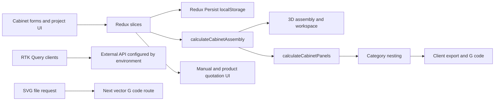
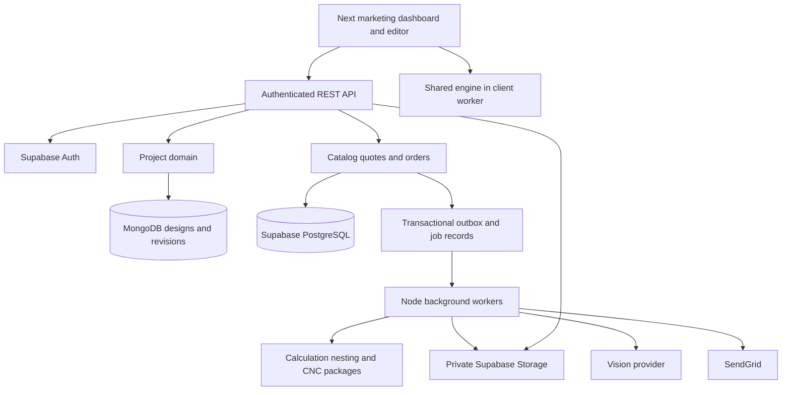

# CutPlan Studio Technical Requirements

Version 1.0 | 21 October 2026 | Engineering planning baseline

The new application should preserve the existing project's useful geometric algorithms while rebuilding identity, durable projects, pricing, orders and manufacturing release around explicit contracts. Shared calculation code must produce the same result in the editor and on the server. Commercial and manufacturing decisions must use server-validated, immutable design revisions.

The [PRD](01_PRD.md) controls product scope. The [database design](05_Database_Design.md) defines persistence and ownership. Technology names below follow the master document; specific package and provider versions must be pinned and compatibility-tested when implementation begins.

## 1 Evidence and limitations

Source A is `Cutplan_Studio_Master_Document.docx`, especially Parts 3 and 4. Source B is the existing project at `D:\himu\EaseIT\v0-cabinet-cutting-generator`, commit `5ef2b68eb0d072b3a00878258ba66be4348b0434`. Findings below are based on source inspection and one execution of the existing test entry point. A full application build, browser journey, backend deployment and physical CNC trial were not performed during this planning review.

The package manifest declares Next.js 16.0.6, React 19.2.1, TypeScript, Tailwind v4, Redux Toolkit and Redux Persist, React Three Fiber, Drei, Three.js, Paper.js, polygon-offset, pdf-lib, Prisma and MongoDB. It also includes `maxrects-packer`, but `lib/nesting/nesting-engine.ts` contains its own MaxRects, guillotine and multi-strategy implementations. Dependency presence is not evidence of live integration.

## 2 Existing architecture and data movement



Cabinet forms populate `CabinetInput` with dimensions, construction type, compartment and section trees, doors, drawers, back placement and toe-kick. `calculateCabinetAssembly` orchestrates carcass, frames, doors and section calculators. It can split a cabinet by width and height before generating transformed `AssemblyPart` objects.

`calculateCabinetPanels` groups assembly parts into cut-list quantities. The 3D views render the assembly parts, which is an important pattern to retain: geometry and cut lists originate in one calculation pipeline. The current grouped panel key does not contain all future material, finish, thickness, grain and operation identities, so it cannot serve as the new manufacturing identity.

The cabinet and project pages divide panels into body, front and back categories, then invoke nesting separately. Category grouping is a useful starting point but is insufficient when two panels in one category use different board SKUs, thicknesses, finishes or grain constraints.

`generateGCode` produces metric absolute G-code with multiple passes, engraving and path ordering. Existing export controls expose production settings directly to the UI. The new product must enforce export eligibility on the server and use approved machine profiles.

Projects, configurations and quotations are mainly Redux state persisted to the browser. RTK Query clients target an environment-configured external API for users and materials. The inspected repository contains a vector-conversion route but not a complete implementation of the new customer-order services. Generated Prisma output exists; no authored Prisma schema or migrations were found in the inspected file inventory.

## 3 Reuse inventory and required changes

Paths in this table are relative to the existing repository. They are evidence locations and migration candidates, not instructions to copy entire directories.

| Existing source | What it provides | Reuse decision and required work |
| --- | --- | --- |
| `lib/types/cabinet.ts` | Cabinet options, drawers, compartments, sections | Adapt into versioned template contracts; add runtime validation and stable component IDs |
| `lib/nesting/cabinet-assembly-calculator.ts` | Part orchestration and cabinet splitting | Extract as pure engine after construction review; splitting must be explicit rather than silently changing customer construction |
| `lib/nesting/cabinet-calculation/` | Carcass, door, frame and section calculations | Reuse selectively with fixtures; add the other furniture families and per-panel assignments |
| `lib/nesting/panel-calculator.ts` | Assembly-to-cut-list grouping | Retain single-source pattern; group only physically equivalent parts and preserve every instance ID |
| `lib/utils/cabinet-calculations.ts`, `split-logic.ts` | Compartment layouts and splitting | Adapt after reviewing clearances, joinery and naming |
| `lib/utils/unit-utils.ts` | mm and inch/suta conversion | Reuse with round-trip tests and no loss through display rounding |
| `lib/nesting/nesting-engine.ts` | Custom MaxRects, guillotine, sorting strategies | Adapt with explicit unplaced output, deterministic seed, per-panel grain and placement validation |
| `lib/nesting/collision-utils.ts` | Geometry helpers | Review and reuse where supported by new placement invariants |
| `lib/gcode/gcode-generator.ts` and path optimizer | Profile and pocket toolpath foundation | Major adaptation for profiles, operation IDs, bounds, controller qualification and per-sheet files |
| `lib/gcode/engraving-generator.ts`, `lib/utils/pocket-utils.ts` | Pocket width coverage and engraving | Retain supported math after fixtures and tool-width rejection |
| `components/cabinet-3d-view.tsx`, `workspace-3d-view.tsx` | R3F viewing, part meshes and transforms | Adapt into canonical renderer with stable selection, finish textures and visibility controls |
| `components/nesting-preview.tsx`, `design/design-nesting-preview.tsx` | Layout visualization | Reuse drawing concepts; add material groups, IDs and error overlays |
| `components/quotation/` | Itemized layout and print structure | Reuse presentation concepts only; replace manual totals and old company branding with canonical quote snapshots |
| `types/product.types.ts`, material and board API clients | Board, thickness, finish and catalog vocabulary | Use as mapping reference; define normalized new catalog contracts and ownership |
| `components/ui/` | Radix and styled primitives | Reuse selectively after design-token and accessibility audit |
| `store/`, `components/providers.tsx` | Redux state and persistence | Replace editor state with Zustand and server persistence; avoid migrating transient UI state as business records |
| `store/auth/`, `hooks/useAuth.tsx`, `app/login/page.tsx` | Legacy auth clients and UI behavior | Replace with Supabase OTP and server session verification |
| `app/api/vector-gcode/route.ts` | SVG conversion prototype | Defer arbitrary SVG workflows from customer v1; harden separately if retained internally |
| `generated/prisma/` | Generated client artifacts | Do not copy; generate from the new chosen persistence tooling |

### 3.1 Confirmed gaps and risks

1. The declared pocket test fails before assertions: it requires `../utils/pocket-utils.js`, but the checked-in implementation is `.ts`. The entry point was run with bundled Node and returned `MODULE_NOT_FOUND`. No passing legacy regression baseline is established.
2. `next.config.mjs` sets `typescript.ignoreBuildErrors: true`. The new CI must fail type errors instead of inheriting this setting.
3. `store/auth/authSlice.ts` writes tokens to localStorage, and `hooks/useAuth.tsx` recognizes `demo-token`. Neither is appropriate for the new production access boundary. The login route currently redirects rather than implementing the specified OTP flow.
4. The MaxRects placement path logs an oversized item and can omit it from the result. New nesting must reject incomplete output and expose unplaced IDs.
5. `nestPanels` accepts a global rotation flag. It does not propagate the panel's optional `rotate` field into its expanded rectangles. Add per-instance grain and allowed-rotation constraints.
6. Settings default to 2440 by 1220 mm, 4 mm kerf, and a 2413 mm machine limit in one axis. Master defaults differ. Stock size, usable size and machine work area must be separate concepts.
7. `generateGCode` has hardcoded feed, plunge and spindle values. Those are not safe defaults for every material or machine and must come from a versioned approved profile.
8. Panel and nested-item types do not carry a complete material/finish identity. Preserve panel instance IDs through calculation, packing, pricing, labeling and machining.
9. The SVG route parses supplied settings and mutates global DOM parser objects. If retained, it needs request validation, file limits, isolation and concurrency review. It is outside the customer release path.
10. Quotation types support square-foot pricing, manual items and outside-Dhaka transport. These behaviors must not accidentally replace full-sheet pricing and Dhaka-only v1 policy.

## 4 Target architecture

Required technologies from the master: Next.js App Router, React Three Fiber, Tailwind/shadcn, Zustand, Node.js service boundaries, Supabase Auth/PostgreSQL/Storage, MongoDB Atlas, an OpenAI vision integration and SendGrid notifications.

Proposed initial topology: retain independent domain interfaces but group them into a Next.js application/API and a Node worker deployment. This avoids forcing every calculator into an independently operated service on day one. It is a proposal, because the master explicitly describes independent services. If that requirement is retained literally, the same contracts become separate deployables; approve D10 before infrastructure work.



The master lists a separate Auth Service; Supabase remains the identity authority, with the API handling session and authorization checks. Do not implement another password database. Stateless calculation, nesting and CNC domains have no independent business database. Job metadata, versions and artifacts still require persistence.

### 4.1 Proposed code organization

```text
apps/web                 Next.js marketing, studio, admin, REST adapters
apps/worker              Durable background job consumers
packages/contracts      Runtime schemas, API types, errors and versions
packages/furniture      Approved templates and panel calculations
packages/nesting        Grouping, packing and invariant validation
packages/cnc            Operations, postprocessors and machine profiles
packages/pricing        Decimal pricing and snapshot assembly
packages/ui             Design tokens and shared accessible components
packages/data           Postgres and Mongo repositories
```

Packages must not import browser globals into server engines. Renderer dependencies must not be necessary to execute panel mathematics. Keep provider integrations behind interfaces so tests can run without live AI or email calls.

## 5 Geometry and calculation contracts

### 5.1 Common conventions

Canonical lengths are mm; rotations are radians. Use `x` left-to-right, `y` bottom-to-top and `z` back-to-front for furniture coordinates. Panel pose uses its center. A local panel is width along X, height along Y and thickness along Z before its transform. Three.js presentation may scale mm to meters at the scene boundary only. Nesting uses a separate documented bottom-left sheet origin and 2D panel-local coordinates. Machine postprocessors explicitly map that sheet system to the controller origin.

Every response carries `schemaVersion`, `engineVersion`, `projectId`, `revisionId` and an input hash when persisted. Reject NaN, infinity, invalid enums and unknown catalog IDs at API boundaries. Stable panel IDs derive from template/component identity, not current dimensions or human labels.

```ts
type PanelInstance = {
  panelId: string; componentId: string; role: string;
  widthMm: number; heightMm: number; thicknessMm: number;
  pose: { positionMm: [number, number, number]; rotationRad: [number, number, number] };
  boardSkuId: string; frontFinishId?: string; backFinishId?: string;
  edging: { edge: 'top'|'bottom'|'left'|'right'; edgingSkuId: string }[];
  grainAxis: 'none'|'width'|'height'; allowedRotationsDeg: (0|90)[];
  operations: ManufacturingOperation[];
};
```

The canonical pipeline returns individual physical parts. A display cut-list may group identical parts and store the corresponding `panelIds`; it must not destroy their identity. Geometry recalculation preserves overrides for components that survive. Deleted or split components produce an explicit override-migration result rather than silently applying old materials to unrelated parts.

### 5.2 Construction validation

Template configuration includes dimensions, joinery and back-panel policy, doors, shelves, drawers, skirting and material overrides. Valid rules determine clearances, thickness subtraction, panel orientations, supports and hardware. The master shoe-rack arithmetic needs manufacturing approval before becoming a golden fixture. See PRD D01.

Output includes `panels`, `hardware`, `warnings` and `blockingErrors`. Validation checks positive internal dimensions, minimum part size, component intersections, hardware compatibility, structural template limits and usable stock fit. Per-panel thickness changes can affect neighboring dimensions, not just a mesh's appearance.

### 5.3 Nesting contract

Input is a validated revision plus material groups and machine constraints. Group keys include board SKU, thickness, sheet dimensions, finish or layup requirements and grain direction. Start with rectangular 0/90-degree packing; unsupported nonrectangular geometry is rejected rather than approximated for production.

Output contains sheet IDs, stock group IDs, panel placements, rotation, unplaced IDs, cut spacing, margins and metrics. Every instance must appear exactly once in placements or unplaced. Validate collisions, containment, allowed orientation and quantity conservation independently of the packing algorithm.

Report `panelArea / purchasedSheetArea` as utilization and its complement as non-panel area; the latter includes kerf and margins and is not all reusable offcut. If reporting reusable offcut, calculate a separate recoverable-area metric. Compare deterministic candidate layouts by sheet count, then agreed waste/path criteria. Do not claim global optimality.

Freeze the stock and manufacturing capability envelope used to quote. Because the manufacturer may be assigned later, a selected profile must support the accepted usable area, cutter spacing, operations and hold-down assumptions. Reject incompatible assignments rather than silently repacking an accepted layout. Distinguish packing clearance from tool-radius compensation: minimum gap and outer margin must contain the actual compensated toolpath; do not apply kerf twice to the same finished dimension.

## 6 API boundaries

All routes below are proposed versioned contracts. Payloads use runtime schemas. Customer ownership is derived from verified server identity, never a client-supplied user ID.

| Method and route | Access | Result and important rules |
| --- | --- | --- |
| `POST /api/v1/guest-sessions` | Rate-limited public | Opaque secure guest cookie and server-side draft identity |
| `POST /api/v1/auth/otp`, `POST /auth/verify` | Public with limits | Send/verify OTP through Supabase; resume approved return action |
| `POST /api/v1/projects/claim` | Authenticated plus guest secret | Idempotent ownership transfer of this guest's draft |
| `GET /api/v1/projects`, `POST /projects` | Customer | List own projects or create a typed draft |
| `GET /api/v1/projects/:id` | Owner or scoped read-only share | Revision, configuration and permission capabilities |
| `PATCH /api/v1/projects/:id` | Owner | Save with expected revision/ETag; conflict returns 409 |
| `POST /api/v1/calculations` | Guest or customer with limits | Validated geometry preview; server reruns for quote |
| `GET /api/v1/catalog` | Public | Active sellable catalog and compatibility data |
| `POST /api/v1/uploads` | Scoped guest or customer | Signed upload destination with MIME and byte limits |
| `POST /api/v1/ai/suggestions` | Scoped session with quota | Photo analysis job and structured candidate designs |
| `POST /api/v1/projects/:id/ai-edits` | Owner or guest draft owner | Validated command proposal; separate apply action |
| `POST /api/v1/quotations` | Customer | Idempotent quote job for exact revision; returns 202 |
| `GET /api/v1/jobs/:id` | Request owner or admin | Progress/result; no other users' payloads |
| `GET /api/v1/quotations/:id` | Owner or admin | Immutable priced snapshot and expiry |
| `POST /api/v1/quotations/:id/email` | Owner | Idempotent email dispatch to verified recipient policy |
| `POST /api/v1/orders` | Customer | Atomic quote acceptance, address validation and order creation |
| `GET /api/v1/orders/:id` | Owner or admin | Status history and customer-safe files |
| `POST /api/v1/projects/:id/shares` | Owner | Scoped, expiring and revocable revision link |
| `/api/v1/admin/catalog/*` | Admin | Validated and audited catalog changes |
| `PATCH /api/v1/admin/orders/:id/status` | Admin | Legal transition with expected version and reason |
| `POST /api/v1/admin/orders/:id/manufacturer` | Admin | Qualified bid assignment and audit |
| `POST /api/v1/admin/orders/:id/production` | Admin | Retry/generate against immutable order and machine profile |
| `POST /api/v1/files/:id/download` | Per-file capability | Short-lived URL after ownership and artifact checks |

Errors use `{code, message, fieldErrors?, requestId, retryable}`. Expected statuses include 400 malformed input, 401 missing session, 403 forbidden action, 404 inaccessible resource, 409 stale revision or invalid transition, 422 invalid geometry, 429 quota, and 503 retryable provider failure. Never return stack traces or storage credentials.

## 7 Identity and application state

Use email OTP as specified in Part 4.4. Supabase identity maps to `auth.users.id`. The server validates sessions and refreshes them using the supported Supabase server integration selected during implementation. Session cookies are secure, httpOnly, same-site and host-scoped where practical. No legacy demo token or localStorage JWT is accepted. Apply origin checks and CSRF protection to cookie-authenticated mutations.

Zustand holds in-memory editor configuration, selection, camera, display mode and undo history. Persistent data belongs in project repositories; IndexedDB/local recovery is a cache, not proof of ownership. Debounced saves include the expected revision. Abort or ignore stale calculation responses. A failed save leaves unsaved state visible and recoverable.

Guest drafts are server-scoped by an opaque session secret; a project ID is not authorization. Claiming a draft after OTP checks that secret and is idempotent. Never accept an arbitrary anonymous project ID for transfer. A shared link provides a separate read-only capability and never authorizes a claim.

## 8 Quotation and order consistency

The server freezes a validated design revision, material-price versions, nesting result and pricing formula version. It calculates money in decimal arithmetic or integer minor units and stores exact decimal SQL values. Browser totals are advisory only.

Proposed monetary rule: compute each line from its exact quantity and unit price, round each charge to 2 BDT decimal places using one approved rounding mode, sum rounded lines into subtotal, then calculate `total = subtotal + tax - discount`. Delivery is a subtotal line. Tax and discounts remain zero unless the business enables them. Store the rounding policy with the quote and reproduce it in the PDF; do not independently recalculate totals in the browser.

Within one Postgres transaction, order placement locks the quote, validates owner, expiry, revision and service area, inserts the order with a unique quotation reference, marks quote acceptance, and appends an outbox event. A unique idempotency key returns the original order on retries. Avoid any distributed transaction with MongoDB.

The immutable design revision must exist in MongoDB before the quote becomes usable. Quote creation records an operation ID in both systems; retries reuse it. A reconciliation process finds missing mirrors or orphan revisions. Postgres project records are indexes and authorization metadata; MongoDB owns the detailed design body.

An order stores an immutable accepted snapshot and references its revision. Subsequent project editing forks a new revision and cannot change production files or the order's price. Quote PDF failure or email failure must not erase a valid quote. A worker failure must not duplicate a confirmed order.

## 9 AI and uploaded media

The master names GPT-4o Vision. Treat the provider/model as configurable rather than assuming that name remains the selected deployment model. Verify supported structured-output and image capabilities against provider documentation at implementation time.

Photo inference returns supported furniture family, style, suggested configuration, confidence and measurement assumptions. A photograph without a scale reference cannot establish exact dimensions. Require customer-entered or measured W/H/D before quotation. Product references map to approved templates instead of inventing arbitrary manufacturable meshes. Validate every AI response and command with the same schemas and PCE used for manual changes.

AI text and image content are untrusted data. The model cannot access service credentials, set prices, accept orders, alter access roles, execute code or generate machine-ready instructions directly. Commands such as `addShelf` or `setDimension` are allowlisted, previewed and applied as one undoable change. Negative, nonfinite, out-of-range or unsupported results are rejected.

Proposed upload defaults are JPEG/PNG/WebP, 10 MB maximum, decoded-pixel limits and metadata stripping. Store uploads privately, expose only time-limited URLs, rate-limit guest AI by session and network signals, and enforce provider cost quotas. Retention durations are proposals in the database design, not approved privacy policy.

## 10 Production files and fulfillment

Generate one G-code file per sheet using a qualified postprocessor. The artifact manifest records order ID, revision, panel IDs, stock group, machine-profile version, engine version, tool and checksum. Preserve one accepted nesting snapshot; never repack it silently when retrying PDF or email generation.

Validate finite coordinates, working bounds, safe retract, feeds and spindle limits, pass depth, stock thickness, tool diameter, pocket depth and operation order. Pockets and holes run before outside profiles when appropriate. Tabs, hold-down, spoilboard allowance, drilling strategy and machine dialect require manufacturing decisions; unsupported operations block release. Generic RS-274 text is not a universal compatibility guarantee.

Generate cut-plan PDF, labeled part list, hardware list and template-based assembly guide from that same snapshot. Assembly instructions need approved fastening, orientation, sequence and wall-fixing guidance where applicable. The old 3D assembly view is useful source material but does not itself provide an assembly guide.

Required export trigger is resolved provisionally as order confirmation. Automatic generation may finish before manufacturer assignment only if a valid machine profile is already selected; otherwise the job remains awaiting profile. Admin review controls the release to the partner outside the app.

## 11 Deployment and operations

Proposed production placement follows the master: Vercel for Next.js, Supabase for Postgres/Auth/Storage, MongoDB Atlas for design documents, and Node workers wherever durable runtime limits permit. Long calculation, CNC and PDF work must not rely on a browser remaining open or an untracked serverless request.

Use distinct development, preview and production databases, buckets and provider credentials. Preview must not read production customer designs by default. Keep service-role, Mongo, AI and SendGrid secrets server-only; public frontend configuration must contain only public identifiers.

Workers use persistent job records, leases, heartbeats, bounded retries and terminal failure states. Process notifications through an outbox; duplicate messages are safe. Record request/job/quote/order IDs and engine versions. Monitor failed quotes, order confirmation errors, production failures, unauthorized access, AI spend and outbox age. Redact customer addresses, image URLs and session secrets from logs.

Proposed operational targets: daily database backups with a tested restore path, monthly recovery exercises during pilot, and documented retention and incident ownership. Final recovery objectives and provider-region requirements require an approved cost and operations plan.

## 12 Verification and implementation gates

| Layer | Required evidence |
| --- | --- |
| Calculation | Approved expected panels and transforms for all four types; thickness/back/door/skirting boundaries; deterministic output; no invalid dimensions |
| Nesting | Quantity conservation, no collisions, margin containment, grain lock, multiple SKUs and oversized-part rejection |
| Pricing | Exact BDT arithmetic, full-sheet costs, no duplicate finish/waste charge, immutable old prices, 7-day expiry boundary |
| Identity | Guest claim replay, share isolation, owner access, admin access and forged IDs fail correctly |
| Persistence | Concurrent save conflict, refresh recovery, partial Mongo/Postgres write and idempotent retries |
| Orders | Expired quote refusal, double-click confirmation, legal status transitions, unchanged accepted snapshot |
| AI | Invalid JSON, uncertain dimensions, unsupported family, provider outage, malicious instructions and undo after apply |
| Production | Per-sheet output, controller parser/simulator validation, tool constraints, operation order and supervised physical qualification |
| UI | Guest-to-order flow, dark/light themes, keyboard paths, touch alternative, WebGL fallback, failed save and failed quote recovery |
| CI | Typecheck, lint, engine tests, repository tests, production build and secret scanning; no ignored type failures |

Start by establishing tests around extracted code rather than copying the entire app. Pin dependencies, remove unused generated/native assets, and verify license and image/texture provenance before redistribution. The old README's MIT statement is not by itself a complete asset-rights audit.

## 13 Cross-document traceability

PRD-02 to 04 map to identity, Zustand and project repositories; PRD-05 to 09 and 12 map to the PCE and renderer; PRD-10 to 11 map to the AI adapter and validated commands; PRD-13 maps to nesting; PRD-14 to 16 map to quote/order transactions; PRD-17 maps to the catalog domain; PRD-18 to 19 map to production jobs and storage; PRD-20 maps to scoped share records. Field-level tables and access policies are in the database design; screen states and interaction details are in the design and user-flow documents.
