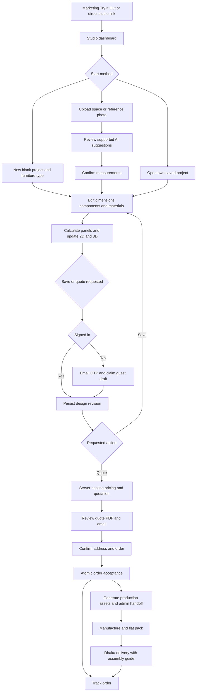
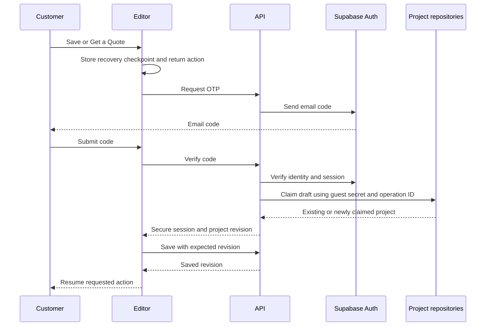
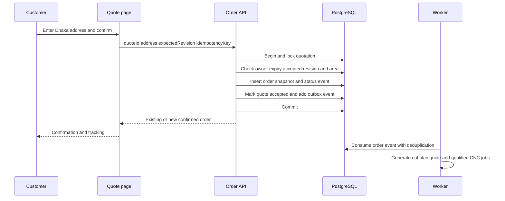
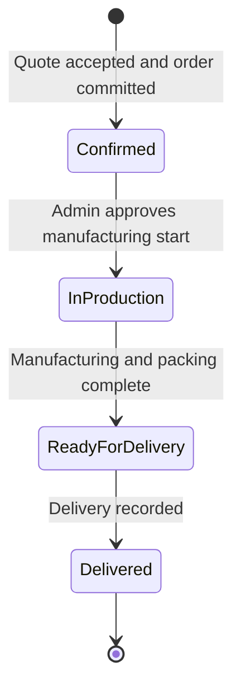

# CutPlan Studio User Flows

Version 1.0 | 21 October 2026 | Customer and operations behavior

These flows define how a design becomes a saved project, quotation, order and manufacturing package. Every commitment identifies the design revision it uses. A canceled login, failed request or repeated button click must not discard work, create duplicate orders or change an accepted specification.

Sources are the master document Parts 2 to 5 and the inspected legacy configuration/export flow. **Required** behavior comes from the master. Recovery, permission and idempotency details are proposed implementation rules supporting that behavior. Refer to the [PRD](01_PRD.md), [TRD](02_TRD.md), [design](03_Design_Specification.md) and [database](05_Database_Design.md) for constraints.

## 1 Complete journey

The login gate occurs before quote generation, as specified in the authentication sections. The master's later mention of login on Confirm Order is a session recheck, not a reason to postpone the initial quote gate. Customer authentication and ownership are always revalidated when confirming an order.

## 2 Guest starts a blank project

**Actor and trigger:** visitor selects New Project. No account is required.

1. Establish or resume an opaque guest session and its current temporary draft.
2. Ask for furniture family and optional name. Initialize an approved template with valid default dimensions and material assignments.
3. Open the editor and calculate a complete panel set. Show dimensions, front/floor views and the 3D model.
4. Customer changes values. A valid edit produces a new local state and recovery checkpoint; invalid intermediate input keeps the last valid geometry.
5. Display Temporary Draft and a Save action. The server draft may be recovered using the guest secret; it is not listed as a permanent account project until claimed.

**Success:** the visitor can inspect and change a valid design without logging in. **Recovery:** a refresh resumes the guest draft within the configured retention period. An expired session offers local recovery or a new project and does not claim arbitrary old projects by ID.

## 3 Save with email OTP and guest claim

The modal remembers only an allowlisted return action: Save or Quote for the current draft. Return URLs must not redirect to untrusted domains. Ownership transfer checks the guest secret, not merely the project ID. Replaying the operation returns the already claimed project.

Wrong/expired OTP leaves the design intact and offers resend after cooldown. Changing email resets the code challenge. Cancel returns to the editor. Email-provider failure exposes Retry and leaves the draft usable. If identity succeeds but claim/save fails, retain the local checkpoint and show Retry Save; do not pretend the design is saved.

## 4 Returning customer manages projects

**Precondition:** verified session.

1. Dashboard requests the customer's project summaries and thumbnails.
2. Opening a project checks ownership, loads its current revision, validates schema compatibility and restores the editor.
3. Renaming changes project metadata. Geometry/material edits create a new revision when saved.
4. Delete on an unreferenced draft asks for confirmation and removes it from ordinary listing. Quote/order-linked immutable revisions remain retained according to record policy.
5. Opening a design already ordered does not modify its order. Editing creates a new draft/revision and requires a new quote.

No projects shows New Project and Start from a Photo. A database failure offers Retry and may show cached summaries as cached. A stale browser tab receives a revision conflict and offers preserve-as-copy or reload; it must not silently overwrite the server revision.

## 5 Photo of an empty space

**Trigger:** Start from a Photo, then Empty Space.

1. Customer selects an image and reviews the upload notice. Client and server enforce file and decoded-image limits.
2. Upload privately and create a photo-analysis job scoped to the current session.
3. AI suggests 2 to 3 supported furniture options when feasible, with a brief explanation and measurement assumptions.
4. Customer picks an option and enters/confirms measured width, height and depth. The UI explains that the photo estimate is approximate.
5. Convert the suggestion into a supported template configuration, run normal validation and open the editor.

Low confidence offers another photo or Start Blank. Unsupported geometry offers the nearest supported template only when clearly described as an approximation. Provider timeout may retry the same job; it must not create a second billable request without an idempotency policy. A customer can leave the flow without deleting the existing design. Temporary uploads expire according to the approved retention policy.

## 6 Photo of a reference product

**Trigger:** Start from a Photo, then Furniture Reference.

1. Upload and analyze as in Flow 5.
2. Identify supported furniture family and recognizable components; distinguish inferred features from visible evidence.
3. Show the proposed panel-based interpretation. Unsupported materials, joints or curved parts are disclosed and not manufactured implicitly.
4. Customer confirms dimensions and chooses materials. The server constructs a validated parametric design, not an arbitrary AI mesh.
5. Open editor with the result. Save and Quote follow the normal authentication gate.

There is no guarantee of an exact replica. A failed recognition returns to the dashboard or a blank template while preserving any prior draft.

## 7 Manual editor change

**Precondition:** editable guest draft or owned project.

1. User selects a dimension, component, material or panel edge.
2. Editor validates the command against the current template. A slider drag is one history action, not hundreds.
3. Shared calculation logic generates updated parts, transforms and hardware. A response from an older revision is ignored.
4. Both 2D and 3D reflect the same result. The selected panel remains selected if its stable ID survives.
5. Store a recovery checkpoint and mark the draft unsaved. A saved/quoted design becomes changed; old quotes remain historical but cannot be presented as pricing this changed design.
6. Save with an expected revision and show Saved only after server acknowledgement.

If changing thickness invalidates shelf clearances, show the affected fields/panels and disable quote. An unsupported oversized design cannot be silently split into separate furniture units. A split must be an explicit construction decision with approved joints.

## 8 AI-assisted editor change

1. Customer sends an instruction such as “Add a shelf.” Attach the current revision and allowed command schema.
2. AI returns a structured proposal. Server/client validation rejects unsupported or invalid commands.
3. Show a description of the change and affected dimensions/material overrides. Nothing changes until Apply.
4. If the project revision has changed since the request, revalidate or mark the proposal stale.
5. Apply atomically as one normal editor command; recalculate and allow Undo.

Failure keeps manual controls usable. The assistant cannot set the customer price, confirm an order, change roles, retrieve another customer's design or emit executable manufacturing instructions. Uploaded/reference text is treated as data rather than application instructions.

## 9 Quote generation and review

**Trigger:** Get a Quote. **Preconditions:** signed-in owner, saved valid revision, complete material assignments and confirmed dimensions.

1. If guest, complete Flow 3 and resume the quote action.
2. Save/freeze the exact revision and send an idempotent quote request referencing it.
3. Server reloads authoritative catalog versions, reruns calculation and validates supported construction.
4. Group physical parts by compatible stock and run nesting. Verify that every panel instance is placed exactly once with required clearances and grain.
5. If any panel is unplaced, fail the quote with affected parts and a path back to dimensions/materials. Never reduce the price by omitting failed parts.
6. Calculate full-sheet material cost, approved finishes/edging/hardware, labor and fixed Dhaka delivery. Apply the approved selling-price policy.
7. Persist an immutable quotation and expiry exactly 7 days after issue. Generate its PDF and queue email only on customer request.
8. Display the quote, its revision, totals, validity and material summary. Provide Download PDF, Email Quote, Edit and Confirm Order.

Email and PDF can have separate pending/failed states. Their failure does not invalidate a completed priced quote. An altered design needs a new quote. Catalog changes do not alter an issued quote; refresh creates a new quotation with current prices rather than overwriting history.

### 9.1 Expired quotation

At expiry, disable order confirmation and explain Refresh Quote. Regenerate against the selected design revision and current catalog. Show a changed total before the customer accepts. Never extend an expiry silently or accept the browser's cached valid flag.

## 10 Order confirmation

The amount is Order Total, not Total Paid, until payment is independently verified. A session expiry prompts sign-in and rechecks the quote. An expired quote returns to refresh, an unsupported address returns to address editing, and a stale project/quote mismatch returns to a new quotation.

Double-clicks and network retries return the same order. If the client times out after commit, retry with the same key or retrieve the confirmation; do not generate another key automatically. A production-generation failure occurs after confirmation and is handled operationally without duplicating or silently canceling the order.

## 11 Tracking and delivery

Required customer-visible lifecycle:

Only admins advance status. Each change records previous status, new status, actor, timestamp and optional note. Prohibit arbitrary backwards updates; exceptional corrections need an explicit audited procedure. Cancellations, refunds and failed-delivery statuses require business policy and are not silently added to the customer state machine.

Customer sees the accepted design, amount, delivery information and timeline. Assembly PDF becomes available when generated and approved. Notification failure does not revert the order status. Delivered is recorded from an operational confirmation, not an automatically elapsed timer.

## 12 Admin catalog maintenance

1. Admin opens a catalog family: boards, finishes, edging, compatible hardware or pricing rules.
2. Create or edit with required dimensions, units, prices, compatibility and availability.
3. Validate positive measurements, valid references and the effective date; preview the change where useful.
4. Publish a new price/rule version and record the actor and reason.
5. New quotes use the new version. Existing quotations and orders retain their snapshots.

Retire a referenced item instead of deleting it. An unavailable material in an editable draft prompts substitution and recalculation. Do not alter an accepted order to a cheaper/different board without a separate approved change process.

## 13 Admin manufacturer assignment and production release

**Precondition:** confirmed order with accepted immutable design and quote.

1. Review customer configuration, panel/hardware list, material availability and any blocking manufacturing warnings.
2. Compare eligible partner bids for the order scope. Select the lowest qualified cost or record a justified override.
3. Assign the manufacturer's approved machine profile and verify it against the manufacturing capability envelope frozen at quotation. If no compatible profile exists, retain Awaiting Profile and do not release generic code or silently repack the accepted design.
4. Generate per-sheet toolpaths, cut-plan PDF, labels and assembly guide from the accepted snapshot. Jobs may start automatically at order confirmation when prerequisites exist.
5. Review panel conservation, layout bounds, tooling, operations and manifest revisions. Release files only after checks pass.
6. Download and share files with the manufacturer outside the platform in v1. Record handoff and begin production status when operations confirms it.
7. Update Ready for Delivery after manufacturing/packing checks; record Delivered after fulfillment.

Retries reuse the same order/revision and create an artifact version with a checksum. If the machine profile changes, the previous artifact is superseded and must not remain the default download. Costs and machine files are never exposed through customer share links.

## 14 Shared project review

An owner creates a scoped link to a specific revision. The recipient opens a read-only design with no address, private photos, internal cost, AI history or CNC access. Expired/revoked links display an unavailable state without leaking whether a private project exists.

Signing in enables editing only if the viewer is the owner. The master's phrase “sign in to edit” does not imply that anyone with the link becomes an editor. Proposed copy/fork behavior requires an explicit permission separate from view access.

## 15 Recovery matrix

| Failure | Visible response | Preserved data | Next action |
| --- | --- | --- | --- |
| Invalid dimension or unsupported assembly | Inline field/panel explanation | Last valid design and typed draft | Correct input |
| Offline or save timeout | Unsaved or Save Failed indicator | Local recovery and server version | Retry with expected revision |
| Concurrent tab save | Conflict notice | Both revisions/local checkpoint | Reload or save a copy |
| OTP invalid or email outage | Challenge error and cooldown | Guest draft and return action | Retry/change email/cancel |
| AI timeout or low confidence | Clear limitation | Existing design and upload reference until expiry | Retry or start manually |
| Nesting incomplete | List of unplaced parts | Design and diagnostics | Fix dimensions, stock or grain |
| Price/catalog unavailable | Quote unavailable | Saved design and previous quote history | Retry or choose available material |
| Quote expired | Refresh action | Original quote and design revision | Review new quote |
| Order response lost | Checking confirmation | Idempotency key and committed order | Recover existing order |
| PDF/email failure | Per-action failure | Valid quote/order | Retry that job only |
| Production failure | Admin diagnostic, customer-safe status | Confirmed order and accepted snapshot | Fix profile and retry |
| Shared link revoked | Unavailable view | Owner's private project | Request a new permitted link |

## 16 Scenario acceptance set

Use these as end-to-end scenario IDs, with deterministic fixture data.

| ID | Scenario | Expected outcome |
| --- | --- | --- |
| FLOW-01 | Guest blank design, cancel OTP, resume editing | No work lost and no permanent account claim |
| FLOW-02 | Guest logs in and double-submits claim | Exactly one owned project, correct return action |
| FLOW-03 | Reference photo has no real-world scale | Measurement confirmation required before quote |
| FLOW-04 | Change board thickness after a valid quote | Geometry recalculated and a new quote required |
| FLOW-05 | Panel exceeds usable stock with grain locked | No incomplete quote or released production file |
| FLOW-06 | Two tabs save against one revision | Explicit conflict, no silent overwrite |
| FLOW-07 | Confirm quote at exact expiry boundary | Server rejects when current time is at or beyond expiry |
| FLOW-08 | Repeated confirm after network timeout | Same order ID and one acceptance/outbox record |
| FLOW-09 | Another customer tries a project/order/file ID | No unauthorized data or file URL |
| FLOW-10 | AI command returns an invalid shelf count | No design mutation; manual editing remains available |
| FLOW-11 | Worker crashes during file generation | Lease recovery and safe retry, no duplicate order |
| FLOW-12 | Catalog price changes after acceptance | Order value and accepted manufacturing snapshot unchanged |
| FLOW-13 | Shared viewer signs in as non-owner | View-only remains view-only |
| FLOW-14 | Admin completes lifecycle and assembly PDF | Customer timeline and permitted guide match accepted order |

These flows cover the complete v1; they do not imply that the old application already implements customer ordering, AI or cloud persistence.
