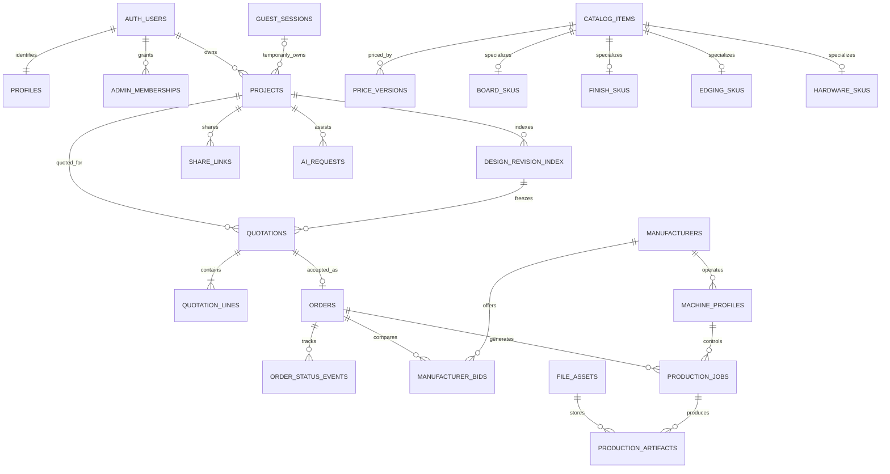

# CutPlan Studio Database Design

Version 1.0 | 21 October 2026 | Logical schema and persistence contracts

PostgreSQL owns identity references, catalog, prices, quotations, orders and operational records. MongoDB owns flexible furniture designs and their immutable revisions. Supabase Storage owns file bytes; PostgreSQL records file identity and permissions. A commercial record always points to a frozen design revision, so later edits cannot change a quotation or manufacturing instruction already accepted.

This is a proposed logical design ready to guide implementation, not an executed migration. It expands the master's Part 4.3 into relationships, field contracts, constraints and recovery rules. Read with the [PRD](01_PRD.md), [TRD](02_TRD.md), [design](03_Design_Specification.md) and [user flows](04_User_Flows.md).

## 1 Ownership and storage decisions

| Data | Authoritative location | Reason |
| --- | --- | --- |
| Login identity and OTP | Supabase Auth | One managed identity authority |
| Customer profile and admin membership | PostgreSQL | Permissions and business references |
| Project index and ownership | PostgreSQL | Customer listing, commerce references and access checks |
| Editable design and immutable revisions | MongoDB | Versioned, variable furniture configuration and panel arrays |
| Material catalog and prices | PostgreSQL | Referential integrity and price versioning |
| Issued quote and accepted order | PostgreSQL | Transactional money and lifecycle |
| Nesting snapshot | MongoDB nesting_snapshots collection | Immutable result linked to the exact revision and engine version |
| Files and textures | Private Supabase Storage, with metadata in SQL | Controlled URLs and independent file lifecycle |
| Jobs, status history and email outbox | PostgreSQL | Retry safety and audit |
| Editor selection, camera and temporary history | Zustand and optional local recovery | UI state; not commercial truth |

The master says projects are relational in one table and documents in another. Proposed resolution: SQL stores a minimal project index and MongoDB stores the design body. SQL quotes are authoritative; any quote-related Mongo metadata is a revision reference or cached calculation, never a second mutable price ledger.

## 2 Conventions

- SQL IDs are UUID unless explicitly documented. User IDs reference `auth.users.id`. Mongo project `_id` is ObjectId and is represented externally as a 24-character hex string. SQL `projects.id` stores that exact string.
- Design revision IDs are application-generated UUID strings, used consistently in Mongo and SQL. They are not auto-incremented row numbers.
- All SQL timestamps use `timestamptz` and UTC; display uses Asia/Dhaka. Mongo stores BSON dates in UTC. Expiry checks use server time.
- SQL money is `numeric(14,2)` in BDT; calculate with decimal arithmetic or integer minor units, never binary floating point. `currency` is constrained to `BDT` for v1. Quantity/rates use appropriate exact numeric precision.
- Dimensions use mm, poses use mm and radians, areas use mm2 internally, and edging price quantities use meters. Use explicit unit suffixes. JSON numbers must be finite.
- Every mutable business record has `created_at`, `updated_at` and `version` where concurrency matters. Use server-side writers for invariants that cannot be expressed as SQL checks.
- Catalog entities are retired with `is_active=false`; quote/order snapshots remain intact. Ordinary project deletion is soft deletion until retention policies and dependencies allow purge.
- A foreign key to a design revision cannot cross into MongoDB. SQL revision index rows and application validation enforce this boundary, with reconciliation for partial writes.

## 3 Entity relationships



Additional relationships described below include labor rates, service areas, file ownership, job/outbox causation and quote/order snapshot references. Diagram cardinalities show intended business relations; field constraints remain authoritative.

## 4 PostgreSQL identity and project tables

### 4.1 profiles

`id uuid PK FK auth.users(id)`, `display_name text`, `phone text nullable`, `created_at timestamptz`, `updated_at timestamptz`.

Do not duplicate passwords or OTP values. Keep email identity in Supabase Auth; a quote/order can store a deliberate contact snapshot. Phone normalization and verification requirements are product decisions. The supplied developer's personal contact information is not seed customer data.

### 4.2 admin_memberships

`user_id uuid PK FK auth.users`, `role text CHECK IN ('admin','operator')`, `is_active boolean`, `granted_by uuid FK auth.users nullable`, `created_at`, `updated_at`.

Only a privileged administrative process grants roles. Customers cannot update their membership through profile editing. Proposed role split: admin maintains catalog/pricing and membership; operator manages fulfillment and files. If v1 uses one role, enforce the narrower permissions in code until the split is implemented.

### 4.3 guest_sessions

`id uuid PK`, `token_hash text UNIQUE NOT NULL`, `claimed_by uuid FK auth.users nullable`, `claimed_at timestamptz nullable`, `expires_at timestamptz NOT NULL`, `created_at`, `last_seen_at`.

The raw token lives only in a secure cookie. Hash a cryptographically random high-entropy token. Require claimed_by and claimed_at together. Rate-limit creation. SQL cleanup must not delete a session with unprocessed claim work or retained order references.

### 4.4 projects

| Field | Type and constraint | Meaning |
| --- | --- | --- |
| `id` | text PK; 24 hex characters | Same identity as Mongo design document |
| `owner_user_id` | uuid FK auth.users nullable | Claimed customer owner |
| `guest_session_id` | uuid FK guest_sessions nullable | Temporary owner before claim |
| `name` | text NOT NULL; length limit proposed 120 | Customer project label |
| `furniture_type` | enum cabinet/bookshelf/shoe_rack/table | Approved family |
| `current_revision_id` | uuid nullable | Latest completed saved revision |
| `version` | integer NOT NULL default 1 | Optimistic save version |
| `sync_status` | enum pending/ready/error | Cross-store write reconciliation |
| `thumbnail_asset_id` | uuid FK file_assets nullable | Authorized preview |
| `deleted_at` | timestamptz nullable | Soft deletion |
| `created_at`, `updated_at` | timestamptz NOT NULL | Listing and history |

CHECK exactly one of owner_user_id and guest_session_id is non-null. Claim changes both atomically in SQL and updates Mongo through an idempotent operation. Queries require `sync_status='ready'` for quoteable revisions. Do not use project status as order status; a project can have an older ordered revision and a newer draft.

Indexes: `(owner_user_id, updated_at DESC) WHERE deleted_at IS NULL`; `(guest_session_id) WHERE deleted_at IS NULL`; and `(sync_status, updated_at)` for repair work.

### 4.5 design_revision_index

`id uuid PK`, `project_id text FK projects`, `revision_number integer`, `schema_version integer`, `engine_version text`, `config_hash text`, `panel_hash text`, `snapshot_hash text`, `mongo_revision_id text UNIQUE`, `state enum pending/ready/error`, `created_by uuid nullable`, `created_at`.

UNIQUE `(project_id, revision_number)` and UNIQUE `(project_id, id)` support composite references. The Mongo revision must exist and match hashes before `state=ready`. `projects(current_revision_id,id)` may be enforced against `(id,project_id)` with a deferred composite FK after table creation. Revision content is immutable when ready.

## 5 PostgreSQL material and pricing tables

### 5.1 brands and catalog_items

`brands`: `id uuid PK`, `name text UNIQUE`, `is_active boolean`, timestamps.

`catalog_items`: `id uuid PK`, `kind enum board/finish/edging/hardware`, `code text UNIQUE`, `name text`, `brand_id uuid FK brands nullable`, `is_active boolean`, `description text nullable`, timestamps.

Each item has exactly one matching specialization. Enforce that through constrained writes or a trigger; ordinary FKs alone do not enforce the discriminator. This shared identity lets price versions and quote lines reference an item without a polymorphic foreign key.

### 5.2 board_skus

`item_id uuid PK FK catalog_items`, `material_type enum coreboard/mdf/particle`, `width_mm numeric(10,3)`, `height_mm numeric(10,3)`, `thickness_mm numeric(8,3)`, `grain_axis enum none/width/height`, `surface_mode enum bare/prefinished`, `default_front_finish_id uuid nullable`, `default_back_finish_id uuid nullable`, `includes_finishes boolean`, `stock_state enum available/unavailable/on_request`.

All measurements CHECK greater than zero. A board's actual size is stored here; 1219 by 2438 mm is a nominal initial default, not a global constant. Brand, thickness, dimensions and surface identity distinguish SKUs. Defaults reference finish_skus. Do not infer supplier inventory quantities from the old app's stock fields without an agreed inventory process.

### 5.3 finish_skus

`item_id uuid PK FK catalog_items`, `finish_kind enum hpl/liner/prefinished`, `texture_asset_id uuid FK file_assets nullable`, `base_color text nullable`, `texture_repeat_width_mm numeric nullable`, `texture_repeat_height_mm numeric nullable`, `has_direction boolean`, `requires_lamination boolean`.

`board_finish_compatibility`: `board_item_id uuid FK board_skus`, `finish_item_id uuid FK finish_skus`, `face enum front/back/either`, PK `(board_item_id,finish_item_id,face)`.

Textures are visual assets with provenance and permissions; an image is not the finish's pricing identity. Bare-board plus laminate pricing must not duplicate prefinished-board inclusions.

### 5.4 edging_skus and hardware_skus

`edging_skus`: `item_id uuid PK FK catalog_items`, `material enum acrylic/pvc/aluminum`, `thickness_mm numeric(8,3)`, `width_mm numeric(8,3)`, `finish_item_id uuid nullable FK finish_skus`; dimensions positive.

`hardware_skus`: `item_id uuid PK FK catalog_items`, `hardware_kind text`, `specification jsonb`, `unit enum each/set`.

`board_edging_compatibility`: board_item_id, edging_item_id, minimum/maximum compatible panel thickness where needed. `template_hardware_rules`: template_key, template_version, hardware_item_id and a validated quantity/placement rule reference. Do not store executable arbitrary JavaScript in rule JSON.

### 5.5 price_versions

`id uuid PK`, `catalog_item_id uuid FK catalog_items`, `version integer`, `unit enum sheet/m2/linear_m/each/set`, `cost_bdt numeric(14,2)`, `sell_bdt numeric(14,2) nullable`, `effective_from timestamptz`, `effective_to timestamptz nullable`, `created_by uuid FK auth.users`, `created_at`.

CHECK nonnegative prices, effective_to greater than effective_from, and UNIQUE `(catalog_item_id, version)`. Prevent overlapping effective periods for the same item and unit with an exclusion constraint or a transaction that locks the item. If PostgreSQL range exclusion is used, include the required extension in the eventual migration.

The business must choose whether sell_bdt is explicit or derived from an approved margin rule. Snapshot the outcome on quotation lines. Units must match the catalog specialization; enforce through validation/trigger where a cross-table CHECK cannot do so.

### 5.6 labor_rates and pricing_rule_versions

`labor_rates`: `id uuid PK`, `furniture_type enum`, `version integer`, `hourly_cost_bdt numeric`, `hourly_sell_bdt numeric nullable`, `estimated_hours_rule jsonb`, `effective_from`, `effective_to`, `created_by`, `created_at`. Hour estimates must use approved deterministic parameters.

`pricing_rule_versions`: `id uuid PK`, `version integer UNIQUE`, `formula_schema_version integer`, `rules jsonb`, `effective_from`, `effective_to`, `created_by`, `created_at`.

Rules identify included/excluded finish, edging and hardware charges; cost-to-selling treatment; labor rounding; and any approved tax/discount handling. Keep internal cost fields inaccessible to customers. No unapproved tax, discount, assembly fee or margin percentage is seeded here.

### 5.7 service_areas and delivery_rate_versions

`service_areas`: `id uuid PK`, `code text UNIQUE`, `name text`, `city text CHECK city='Dhaka'`, `is_active boolean`.

`delivery_rate_versions`: `id uuid PK`, `version integer UNIQUE`, `amount_bdt numeric(14,2)`, `effective_from`, `effective_to`, `created_by`, `created_at`.

The fixed v1 Dhaka rate is independent of distance. The allowed area list validates addresses; free-text “Dhaka” is insufficient. Coverage boundaries and rates require operations input rather than invented values.

## 6 PostgreSQL quotations and orders

### 6.1 quotations

| Field | Type and constraint | Meaning |
| --- | --- | --- |
| `id` | uuid PK | Quotation identity |
| `quote_number` | text UNIQUE | Human-readable reference |
| `user_id` | uuid FK auth.users NOT NULL | Owner |
| `project_id` | text FK projects | Project identity |
| `revision_id` | uuid FK design_revision_index | Frozen design |
| `status` | draft/issued/accepted/expired/superseded | Commercial lifecycle |
| `operation_id` | uuid UNIQUE | Cross-store and request idempotency |
| `pricing_rule_version_id` | uuid FK pricing_rule_versions | Calculation policy |
| `nesting_snapshot_ref` | text | Immutable snapshot locator |
| `manufacturing_spec_snapshot` | jsonb | Approved usable-area, spacing, operation and capability envelope for this quote |
| `input_hash`, `snapshot_hash` | text | Geometry and priced record integrity |
| `currency` | text CHECK BDT | Currency |
| `subtotal_bdt`, `tax_bdt`, `discount_bdt`, `total_bdt` | numeric(14,2) nonnegative | Customer totals; tax/discount zero unless enabled by approved policy |
| `issued_at`, `expires_at` | timestamptz nullable until issued | Seven-day validity |
| `contact_snapshot` | jsonb | Verified delivery/email contact for the quote |
| `created_at`, `updated_at` | timestamptz | Operational metadata |

Composite FK `(project_id,revision_id)` must target revision_index `(project_id,id)`. An issued quote requires ready revision, complete lines and expiry. On issuance enforce `expires_at = issued_at + interval '7 days'` using server logic/trigger; timestamp math remains server-owned. Order acceptance checks `now() < expires_at` even if a periodic expiry updater has not run.

Once issued, commercial amounts and snapshot fields are immutable. Mark expired/superseded/accepted through constrained lifecycle operations. Regeneration inserts a new quote. The line sum and total equation are validated in the issuing transaction; cross-row sums cannot be guaranteed with a simple row CHECK.

Indexes: `(user_id,created_at DESC)`, `(project_id,created_at DESC)`, `(status,expires_at)`. Use a server-side sequence or collision-resistant reference generator for quote_number rather than relying on timestamps alone.

### 6.2 quotation_lines

`id uuid PK`, `quotation_id uuid FK quotations`, `line_number integer`, `kind enum board/finish/liner/edging/hardware/labor/delivery/assembly_guide`, `catalog_item_id uuid nullable`, `price_version_id uuid nullable`, `labor_rate_id uuid nullable`, `delivery_rate_version_id uuid nullable`, `description text`, `quantity numeric(18,6)`, `unit text`, `unit_price_bdt numeric(14,4)`, `amount_bdt numeric(14,2)`, `source_snapshot jsonb`.

UNIQUE `(quotation_id,line_number)`. Store stock group IDs, panel IDs, included charges and rounding policy in the snapshot. Full-sheet board quantities are whole positive numbers. Assembly-guide amount is zero. Item/rate references and snapshots preserve provenance if names or availability change later. A separate internal-cost snapshot is admin-only; do not put hidden cost fields in a customer-readable JSON column without column/API controls.

### 6.3 orders

`id uuid PK`, `order_number text UNIQUE`, `user_id uuid FK auth.users`, `quotation_id uuid UNIQUE FK quotations`, `project_id text FK projects`, `revision_id uuid`, `status enum confirmed/in_production/ready_for_delivery/delivered`, `total_bdt numeric(14,2)`, `currency text CHECK BDT`, `delivery_area_id uuid FK service_areas`, `delivery_address_snapshot jsonb`, `recipient_name text`, `recipient_phone text`, `accepted_snapshot jsonb`, `snapshot_hash text`, `manufacturer_id uuid FK manufacturers nullable`, `selected_bid_id uuid nullable`, `version integer`, timestamps.

Address JSON contains street, building/flat, area label and delivery notes, with schema version and length limits. No arbitrary out-of-Dhaka value is accepted as an override. Keep the contact/address snapshot independent of later profile changes.

The accepted snapshot includes furniture summary, revision hashes, material/price versions, selected quote lines and nesting reference. Total equals accepted quote total. Composite revision FK enforces the project relationship in SQL. Match order user/project/revision to quote in the acceptance transaction or a trigger. UNIQUE quotation_id makes one accepted order per quotation; a reordered design needs a new quote.

Indexes: `(user_id,created_at DESC)`, `(status,created_at)`, `(manufacturer_id,status)`. Do not add a paid flag unless a payment ledger and business process exist. Optional future payment records must remain separate from fulfillment state.

### 6.4 order_status_events

`id uuid PK`, `order_id uuid FK orders`, `from_status enum nullable`, `to_status enum`, `actor_user_id uuid nullable`, `reason text nullable`, `order_version integer`, `created_at`.

UNIQUE `(order_id,order_version)`. Append one event with the initial confirmed state and every accepted transition. Update order and event atomically. Enforce the supported forward transitions; corrections require a privileged recorded procedure.

## 7 PostgreSQL manufacturing and files

### 7.1 manufacturers and manufacturer_bids

`manufacturers`: `id uuid PK`, `name text`, `contact_snapshot jsonb`, `capabilities jsonb`, `is_active boolean`, timestamps. There is no manufacturer login portal in v1.

`manufacturer_bids`: `id uuid PK`, `order_id uuid FK orders`, `manufacturer_id uuid FK manufacturers`, `revision_id uuid`, `scope_hash text`, `amount_bdt numeric(14,2)`, `lead_time_days integer nullable`, `qualified boolean`, `qualification_notes text`, `valid_until timestamptz nullable`, `created_by uuid`, `created_at`.

Every bid must match the accepted revision and manufacturing scope. Selection is among qualified current bids, not every price ever quoted by a partner. Preserve selection/override events in audit_events. Constrain selected_bid_id to the same order/manufacturer through a composite FK or validated transaction.

### 7.2 machine_profiles

`id uuid PK`, `manufacturer_id uuid FK manufacturers`, `profile_key text`, `version integer`, `controller_dialect text`, `work_width_mm numeric`, `work_height_mm numeric`, `origin_policy jsonb`, `tool_library jsonb`, `kerf_mm numeric`, `margin_mm numeric`, `safe_z_mm numeric`, `feed_limits jsonb`, `pass_depth_rules jsonb`, `hold_down_policy jsonb`, `qualified_at timestamptz nullable`, `qualified_by uuid nullable`, `is_active boolean`, timestamps.

UNIQUE `(manufacturer_id,profile_key,version)`. Positive dimensional checks and runtime schema validation are mandatory. A qualified version is immutable; changing settings creates a new version. Do not reuse the old hardcoded feed/spindle values as qualification evidence.

### 7.3 production_jobs

`id uuid PK`, `order_id uuid FK orders`, `revision_id uuid`, `machine_profile_id uuid FK machine_profiles nullable`, `input_hash text`, `engine_version text`, `status enum queued/awaiting_profile/running/succeeded/failed`, `attempt_count integer`, `lease_until timestamptz nullable`, `worker_id text nullable`, `error_code text nullable`, `error_detail jsonb nullable`, `created_at`, `started_at`, `finished_at`.

UNIQUE `(order_id,revision_id,machine_profile_id,engine_version,input_hash)` for jobs with a machine profile; explicitly handle NULL profile jobs with a partial unique index. Bounded retries update attempts or create a clearly linked retry record. Structured validation errors are admin-visible; customer APIs receive only safe status.

Validate the selected machine profile against the accepted quotation's manufacturing_spec_snapshot before running. A larger work area alone is insufficient if kerf, supported operations or hold-down requirements differ. Incompatible profiles require another qualified partner or an approved order amendment; never mutate the accepted nesting snapshot.

### 7.4 file_assets

`id uuid PK`, `bucket text`, `object_key text UNIQUE`, `kind enum upload/texture/thumbnail/quote_pdf/cut_plan/gcode/assembly_guide/manifest`, `owner_user_id uuid nullable`, `guest_session_id uuid nullable`, `project_id text nullable`, `revision_id uuid nullable`, `quotation_id uuid nullable`, `order_id uuid nullable`, `mime_type text`, `byte_size bigint`, `sha256 text`, `visibility enum private/public_catalog`, `state enum pending/ready/failed/deleted`, `expires_at timestamptz nullable`, `created_at`, `deleted_at`.

Apply type-specific constraints: an upload has user/guest scope; gcode requires an order/revision and private visibility; quote_pdf requires a quotation; assembly_guide requires an order; public_catalog assets cannot contain customer data. A texture can be public only if explicitly approved. URLs are generated on demand, not stored as permanent authorization-bearing values.

### 7.5 production_artifacts

`id uuid PK`, `production_job_id uuid FK production_jobs`, `file_asset_id uuid FK file_assets UNIQUE`, `artifact_type text`, `sheet_id text nullable`, `stock_group_id text nullable`, `revision_id uuid`, `machine_profile_id uuid nullable`, `manifest jsonb`, `review_status enum pending/approved/rejected/superseded`, `reviewed_by uuid nullable`, `reviewed_at timestamptz nullable`, `created_at`.

For G-code, sheet_id and machine profile are required and each generated sheet has a distinct file. A manifest lists panel IDs and hashes. Release queries require ready file state, successful job, approved review and matching revision/profile. An assembly guide may be generated separately but must still match the accepted revision and approved hardware instructions.

## 8 PostgreSQL sharing and operational tables

### 8.1 share_links

`id uuid PK`, `project_id text FK projects`, `revision_id uuid FK revision_index`, `token_hash text UNIQUE`, `permission text CHECK 'view'`, `created_by uuid FK auth.users`, `expires_at timestamptz nullable`, `revoked_at timestamptz nullable`, `created_at`.

Use a high-entropy opaque token and store its hash. Bind to a frozen revision. Return only a redacted viewer representation. A share link never authorizes ownership transfer, order access or machine-file downloads.

### 8.2 ai_requests

`id uuid PK`, `project_id text nullable`, `base_revision_id uuid nullable`, `user_id uuid nullable`, `guest_session_id uuid nullable`, `input_asset_id uuid nullable FK file_assets`, `purpose enum space_suggestion/product_reference/edit_command`, `provider text`, `model_id text`, `prompt_version text`, `status enum queued/running/succeeded/failed`, `validated_result jsonb nullable`, `error_code text nullable`, `usage_metadata jsonb`, `expires_at timestamptz nullable`, timestamps.

Exactly one session owner is required. Store only validated result data needed for recovery; avoid persisting unrelated sensitive prompt/image content in logs. Applying an edit checks base revision and creates an ordinary project command. AI results never contain authoritative quote prices.

### 8.3 idempotency_keys

`id uuid PK`, `actor_scope text`, `route_key text`, `client_key text`, `request_hash text`, `status enum processing/completed/failed`, `resource_type text nullable`, `resource_id text nullable`, `response_code integer nullable`, `expires_at timestamptz`, timestamps.

UNIQUE `(actor_scope,route_key,client_key)`. Reuse with a different request hash is a conflict. Keep durable order uniqueness even after an idempotency record expires. Actor scope is server-derived identity/session, never arbitrary client identity.

### 8.4 outbox_events and notification_deliveries

`outbox_events`: `id uuid PK`, `event_type text`, `aggregate_type text`, `aggregate_id text`, `dedupe_key text UNIQUE`, `payload jsonb`, `status enum pending/processing/sent/failed`, `attempt_count integer`, `available_at`, `lease_until nullable`, `last_error_code nullable`, `created_at`, `processed_at nullable`.

`notification_deliveries`: `id uuid PK`, `outbox_event_id uuid FK outbox_events`, `recipient_user_id uuid nullable`, `channel text CHECK 'email'`, `template_key text`, `provider_message_id text nullable`, `status enum queued/sent/delivered/failed`, `dedupe_key text UNIQUE`, timestamps.

Insert outbox rows in the same SQL transaction as order acceptance or status update. Workers use leases and idempotent consumers. A provider timeout requires checking delivery state where available; do not assume that no response means no email was sent.

### 8.5 audit_events

`id uuid PK`, `actor_user_id uuid nullable`, `action text`, `resource_type text`, `resource_id text`, `request_id text`, `before_summary jsonb nullable`, `after_summary jsonb nullable`, `reason text nullable`, `created_at`.

Append only. Restrict to privileged readers. Capture price changes, role grants, material retirement, quote acceptance, manufacturer assignment, status corrections and production review. Redact addresses and secrets; audit metadata need not duplicate entire private documents.

## 9 MongoDB document contracts

### 9.1 furniture_projects

Mutable working document. SQL ownership is authoritative and mirrored here for efficient scoped repository checks.

```json
{
  "_id": "ObjectId represented as 24 hex characters",
  "schemaVersion": 1,
  "ownerUserId": "Supabase UUID or null",
  "guestSessionId": "UUID or null",
  "name": "Living room shoe rack",
  "furnitureType": "shoe_rack",
  "templateKey": "shoe_rack_panel_base",
  "templateVersion": 1,
  "version": 3,
  "dimensionsMm": {"width": 813, "height": 1219, "depth": 300},
  "configuration": {
    "constructionProfileKey": "approved profile required",
    "shelfCount": 4,
    "doorCount": 2,
    "skirtingHeightMm": 50,
    "backPosition": "inset",
    "components": []
  },
  "defaultMaterials": {"bodyBoardSkuId": "UUID", "backBoardSkuId": "UUID"},
  "panelOverrides": [],
  "currentRevisionId": "UUID",
  "lastOperationId": "UUID",
  "createdAt": "BSON Date",
  "updatedAt": "BSON Date",
  "deletedAt": null
}
```

This example demonstrates structure, not approved shoe-rack geometry. Door/shelf values require the corrected construction fixture. Exactly one owner/session scope is present. Family-specific configuration uses discriminated schemas; a table does not inherit unsupported cabinet drawer fields accidentally.

Indexes: `{ownerUserId:1,updatedAt:-1}`, `{guestSessionId:1}`, `{deletedAt:1}`, with partial filters where appropriate. Optimistic updates filter by `_id` and expected `version`, incrementing version in the same write. Do not place a TTL index on this collection: claimed or order-referenced designs must never disappear because they originated as a guest draft.

### 9.2 design_revisions

Immutable snapshot collection with `_id` as UUID string, `projectId` as ObjectId, `revisionNumber`, `schemaVersion`, `templateKey`, `templateVersion`, `engineVersion`, `configHash`, `panelHash`, `snapshotHash`, `dimensionsMm`, `configuration`, `materialAssignments`, `panels`, `hardware`, `validationSummary`, `createdAt`, and `createdBy`.

Each panel contains stable panelId/componentId, label/role, widthMm/heightMm/thicknessMm, pose, boardSkuId, front/back finish references, edging array, grain axis, allowed rotations and operation array. `quantity=1` is implicit for physical instances. Cut-list grouping references these instance IDs.

Operation schemas are discriminated: profile contour, pocket with local bounds and depth, or hole with center/diameter/depth. Each has operationId, panelId, face, tool requirement and units. Reject unsupported geometry or a pocket wider/deeper than approved tool/stock constraints.

Indexes: unique `{projectId:1,revisionNumber:1}`, `{projectId:1,createdAt:-1}`, and `{snapshotHash:1}` for diagnostics. Versioned validators reject missing identity and nonfinite/nonpositive dimensions. Enforce the BSON document limit before writing; if large panel sets approach it, store bounded part chunks or immutable Storage objects with hash-verified references. Do not keep unbounded chat or event arrays inside the design.

### 9.3 nesting_snapshots

Immutable calculation results generated after the design revision is ready. Fields: `_id UUID string`, `projectId ObjectId`, `revisionId UUID string`, `engineVersion`, `inputHash`, `resultHash`, `manufacturingSpecSnapshot`, `stockGroups`, `sheets`, `placements`, `metrics`, `unplacedPanelIds`, `createdAt`. Every placement includes sheetId, panelId, xMm, yMm, widthMm, heightMm and rotationDeg. Every sheet identifies stock SKU and actual dimensions.

UNIQUE `(revisionId,engineVersion,inputHash)` supports idempotent calculation. Index revisionId and createdAt for history. A quoteable result has no unplaced IDs and passes independent placement validation. A quote references one exact snapshot. New stock or manufacturing settings produce a different input hash and a new result; they never modify design_revisions or an accepted layout. For large results, store a hash-verified private artifact rather than exceeding MongoDB's BSON limit.

### 9.4 temporary_ai_payloads optional

Only needed if SQL validated_result is insufficient. Fields: `_id UUID`, `requestId UUID`, `ownerScope`, `validatedPayload`, `expiresAt BSON Date`, timestamps. TTL index `{expiresAt:1}` applies only to disposable payloads; cleanup timing is approximate and access checks must enforce expiry immediately. SQL ai_requests remains the job identity.

## 10 Critical transaction and reconciliation rules

### 10.1 Save a revision

1. Verify owner/guest secret and expected project version.
2. Allocate operationId and revisionId; insert pending SQL revision/index metadata with compare-and-swap semantics.
3. Write immutable Mongo revision and update working design with the same operationId and expected version. Reject stale edits.
4. Verify hashes, mark the SQL revision ready and advance the SQL project's current revision. If a step fails, leave a repairable pending operation, not a falsely ready record.
5. A reconciler resolves pending operations from operationId and hashes. A concurrent writer must not overtake another pending save without explicit conflict handling. The repositories serialize per-project commits or reserve versions to avoid divergent heads.

Claim uses the same idempotent pattern across SQL/Mongo ownership. Quote/order endpoints reject pending or inconsistent project ownership. This is an application-level consistency protocol, not a distributed atomic transaction.

### 10.2 Issue a quotation

Load a ready immutable revision, validate current catalog and approved construction, compute nesting and prices, and persist quotation/lines within SQL. Include exact version references and snapshot hashes. Only mark issued after line totals and artifacts references needed for acceptance are valid; a downloadable PDF can still be a separate pending job. No customer-supplied total is accepted.

### 10.3 Accept an order

Within a SQL transaction: lock quote; verify user, expiry and revision; validate service area; insert one order with quote total and immutable snapshot; mark accepted; append confirmed event and outbox row. Unique quote and idempotency constraints prevent duplicate orders. No mutable Mongo write is needed for commercial commit.

### 10.4 Complete a production job

Write artifacts to staged private storage keys, calculate hashes and validate manifests. Insert/update file metadata and production_artifacts, then mark the job succeeded. Downloads require ready records. Cleanup reclaims orphaned staged objects after a grace period. Never mark succeeded merely because one of several sheet files exists.

## 11 Access controls and row policies

| Resource | Customer | Guest | Admin/operator | Shared viewer |
| --- | --- | --- | --- | --- |
| Profile | Own safe fields | None | Limited operational need | None |
| Project and revisions | Own | Current secret-scoped draft | Authorized support/operations | Redacted frozen revision only |
| Active public catalog | Sellable fields | Sellable fields | Manage according to role | Sellable fields |
| Internal cost and bids | None | None | Authorized role only | None |
| Quote | Own customer representation | None | Authorized access | No access unless separately specified |
| Order and address | Own | None | Fulfillment need | None |
| Photos | Own | Own temporary uploads | Explicit support need | None |
| CNC files and machine profiles | None | None | Qualified production access | None |
| Assembly guide | Own order | None | Authorized access | None |

Enable RLS on SQL application tables exposed through Supabase. Use `auth.uid()` for owner policies and a privileged server role for constrained operations. Customers cannot directly insert arbitrary quote totals, orders, role memberships or status updates. Prefer API/RPC transactions with explicit authorization. A service-role credential bypasses RLS, so server repositories still enforce identity and ownership.

MongoDB is private server-side only, with least-privilege credentials and no browser connection string. Scope every query by verified owner/guest/share capability and recheck SQL authorization when needed. Supabase Storage object paths do not themselves prove authorization; mint signed URLs after checking file metadata, owner, expiry and review state. Do not persist JWTs or guest secrets in design JSON.

## 12 Retention backup and schema evolution

Proposed initial values, pending PRD D06: unclaimed guest sessions expire after 7 days of inactivity; temporary uploaded photos expire within 24 hours after analysis completes unless explicitly retained for the design; unneeded AI payloads expire within 7 days. These are proposed technical defaults, not a published retention promise. Operational access enforces expiry even when asynchronous deletion lags.

Orders, accepted quotes, relevant design revisions, manifests and audit history follow a business/legal retention policy that still needs approval. Account deletion must distinguish customer PII removal from retained commercial evidence and must not cascade-delete fulfillment records. Do not put order-linked snapshots under guest TTL cleanup.

Back up SQL, Mongo and storage manifests on a coordinated schedule. Test restoration with hash checks and cross-store reconciliation, including accepted orders and their actual file objects. Provider backups alone do not guarantee that a multi-store snapshot is consistent. Document RPO/RTO after provider plans and budget are selected.

Use versioned SQL migrations and discriminated Mongo schema versions. Read old revisions without mutating accepted snapshots. For a breaking engine change, migrate a copy into a new revision and require a new quote. Keep schema version, template version, pricing version, machine profile version and engine version separate.

## 13 Seed and migration strategy

Seed only approved board SKUs with real dimensions, compatible finishes/edging, supported hardware, allowed Dhaka areas, qualified machine profiles and validated construction fixtures. Prices and labor values must come from the business; do not repurpose legacy sample values as real selling prices.

Legacy Redux/localStorage data is not a cloud database to migrate automatically. If historical projects must be imported, define an explicit import format and consent step, normalize mm and material references, reject unsupported geometry, then create new owned drafts with import provenance. Legacy square-foot quotations are historical references and must not be converted into accepted new-product orders.

Regenerate ORM clients from the chosen schema. Do not copy generated Prisma binaries or assume their original platform matches the deployment. There is no evidence of a complete authored migration history in the inspected repository.

## 14 Schema acceptance criteria

- Owner and guest identity cannot both be present or both be absent for a draft.
- A ready revision points to a hash-verified immutable Mongo snapshot.
- A quote cannot issue with missing panels, incompatible materials, invalid pricing units or incomplete nesting.
- An issued/accepted quote's amounts remain unchanged after catalog edits.
- An order references a quote for the same user, project and revision; repeated acceptance creates one order.
- Quote expiry and order status transitions are enforced on the server.
- Production files match accepted revision, sheet, tooling and machine profile; unreviewed or stale files are inaccessible.
- Guest cleanup cannot erase order-linked records.
- Customer APIs cannot disclose cost prices, bids, role membership controls or production files.
- Recovery tests cover partial cross-store save, worker crash, orphan file cleanup and restore of an accepted order's complete evidence.
